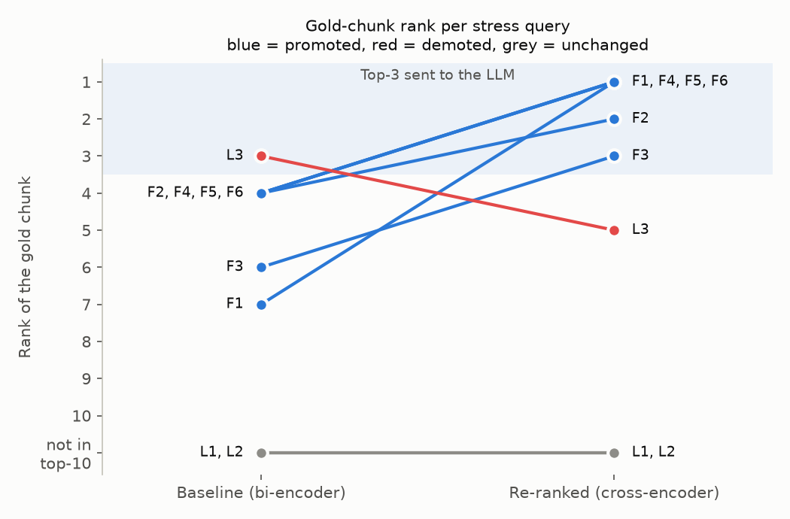
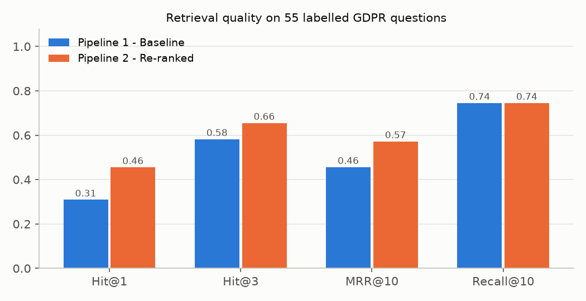

# RAG Report: Baseline Bi-Encoder Retrieval vs. Cross-Encoder Re-Ranking

**Document:** GDPR, Regulation (EU) 2016/679 (88-page official EUR-Lex PDF)  
**Code:** `RAG_Baseline_vs_Reranking.ipynb` (fully executed; every number below is printed in it and saved under `results/`)  
**Hardware:** Intel i5-13500 CPU, 16 GB RAM, no GPU

---

## 0. Summary

| | Pipeline 1 (baseline) | Pipeline 2 (re-ranked) |
|---|---|---|
| Hit@3: gold chunk among the 3 chunks the LLM sees (55 labelled questions) | 0.582 | **0.655** |
| Hit@1 | 0.309 | **0.455** |
| MRR@10 | 0.456 | **0.572** |
| Recall@10: ceiling for both pipelines | 0.745 | 0.745 |
| Mean retrieval latency per query | **22.7 ms** | 238.1 ms |
| End-to-end latency incl. LLM (~12.3 s per answer) | 12.36 s | 12.58 s (+1.7 %) |

* Re-ranking moved the gold chunk **up for 17 questions, left it unchanged for 19, and moved it down for 5**. Six questions entered the Top-3 only because of re-ranking, and two were pushed out of it.
* On all six stress queries (F1–F6) the gold chunk was outside the baseline Top-3 (ranks 4–7) and re-ranking moved it to ranks 1–3. The biggest jump is **F1, from rank 7 to rank 1**.
* In 14 of 55 questions (25 %) the gold chunk was **not in the bi-encoder Top-10 at all**, so no top-10 re-ranker can fix them. This recall ceiling, not the ordering inside the Top-10, is the biggest remaining weakness.
* A better ordering does not guarantee a better answer. With the 0.5B LLM used here, re-ranking clearly fixed the answer in F1, partly fixed F2 and F4, and did **not** fix F3, F5 and F6: there the gold chunk was in context but the small model misread it.

---

## 1. System architecture and design decisions

```
 PDF ──► clean (headers, footnotes, soft hyphens) ──► structure-aware chunking (523 chunks)
                                                            │
                                     bi-encoder (all-MiniLM-L6-v2) ─► 523 × 384 unit-vector matrix  [offline]
                                                            │
 query ─► bi-encoder ─► cosine vs all chunks ─► Top-10 ─────┼──► Top-3 ───────────────► prompt ─► LLM ─► Answer 1
                                                            │
                                                            └──► cross-encoder scores 10 (query, chunk) pairs
                                                                 ─► re-sort ─► Top-3 ─► same prompt ─► LLM ─► Answer 2
```

### 1.1 Document choice: the GDPR
The GDPR was chosen because its structure produces exactly the failure modes the assignment asks for:

* **Two layers that discuss the same topics.** The 173 *recitals* are explanatory, non-binding prose; the 99 *articles* are the binding rules. A recital about fines (Recital 150) is lexically closer to "how much can a company be fined" than the article that states the amount (Art. 83(5)). Recitals are therefore natural distractors.
* **Exceptions everywhere.** Many rules are followed by "Paragraph 1 shall not apply if…" (Art. 9(2), 17(3), 34(3)…).
* **Negations and role limits:** "shall not be dismissed or penalised" (Art. 38(3)), "shall not be competent to supervise… courts" (Art. 55(3)).
* **Vocabulary mismatch.** Users say *delete, fine, fired, ignore, government bodies*; the law says *erasure, administrative fine, dismissed, refuse to act, public authorities and bodies*.

### 1.2 Text extraction and cleaning
`pypdf` extracts text page by page. Two cleaning steps mattered:

1. **Running headers** (`4.5.2016 L 119/32 Official Journal of the European Union EN`) are removed with a regex. Otherwise every chunk would share the same noise tokens.
2. **Page-bottom footnotes** (`(1) OJ L 281, 23.11.1995, p. 31.`) are removed (20 found). This was a real bug in the first version. Footnotes are printed in the middle of the extracted text wherever a recital continues onto the next page, so they cut a recital in two and glued its second half onto a footnote. Because footnotes are also numbered `(1)`, `(2)`, the recital splitter treated them as new recitals. After the fix, all 173 recitals and all 99 articles are recovered.

Soft hyphens (`\xad`) and words hyphenated across line breaks are re-joined.

### 1.3 Chunking: structure-aware and paragraph-level (523 chunks)

| Decision | Reason |
|---|---|
| Split on the legal structure (recitals `(n)`, `Article N`, numbered paragraphs `1.`, `2.`) instead of fixed-size windows | A fixed 500-character window would separate "Paragraph 1 shall not apply…" from its list of exceptions, or merge the end of one article with the start of the next. |
| Max **150 words** per chunk; consecutive paragraphs packed greedily | `all-MiniLM-L6-v2` truncates at 256 word-pieces. Legal English is ~1.4–1.6 word-pieces per word, so 150 words fits (median 132 word-pieces; only 1 of 523 chunks exceeds 256). Bigger chunks would be silently cut. |
| Over-long paragraphs split on `.` `;` `:` and fragments under 30 words merged back | Prevents meaningless tails such as "or (e) for the establishment, exercise or defence of legal claims." |
| Every article chunk prefixed with `Article N - Title:` | A mid-article chunk ("3. Paragraphs 1 and 2 shall not apply…") does not say what it is an exception *to*. The prefix restores that context for both encoders. |
| No overlap between chunks | Paragraphs are natural boundaries in legislation. Overlap would create near-duplicates that compete for the same 3 context slots. |
| Recitals kept as separate chunks (not dropped) | They are part of the document and help some questions. They also act as realistic distractors, which is the point of the stress test. |

Consequence (deliberate): a general rule and its exception usually end up in **different chunks** (e.g. Art. 17(1) "right to erasure" vs. Art. 17(3) "shall not apply…"). That is exactly the "except when…" situation that tests the retrievers.

### 1.4 Stage 1: bi-encoder and vector store
* **Model:** `sentence-transformers/all-MiniLM-L6-v2`, a 6-layer MiniLM (22M parameters) with mean pooling to a 384-dim vector, trained contrastively on ~1B sentence pairs. Chosen because it is the standard lightweight baseline and has the **same backbone size** as the cross-encoder. The comparison therefore isolates the *architecture* (independent vs. joint encoding), not model size.
* **Index:** the 523 normalised embeddings form a `523 × 384` float32 matrix. Search is one exact matrix–vector product (`emb @ q`), which equals cosine similarity for unit vectors and gives the same results as `faiss.IndexFlatIP`. An approximate index (HNSW/IVF) only pays off at ~10⁵ or more vectors, and would add approximation error to an experiment about ranking quality. Indexing takes ~7.7 s once, offline.

### 1.5 Stage 2: cross-encoder re-ranker
* **Model:** `cross-encoder/ms-marco-MiniLM-L-6-v2` (the model suggested in the assignment): 6-layer MiniLM fine-tuned on MS MARCO passage ranking, outputting one relevance logit per (query, passage) pair.
* It scores exactly the 10 bi-encoder candidates. The Top-3 by cross-encoder score goes to the LLM.

### 1.6 Generation
* **LLM:** `Qwen2.5-0.5B-Instruct`, run locally on CPU (open weights, no API key, reproducible). No API key was available, and the internet connection (~150–400 KB/s) made the 3 GB 1.5B model impractical, so the 1 GB 0.5B model was used. The notebook switches to Gemini automatically if `GEMINI_API_KEY` is set.
* **Greedy decoding** (`do_sample=False`), so Answer 1 and Answer 2 differ *only* because the context differs.
* **Identical prompt** for both pipelines. The first prompt ("answer only from the context, cite sources") failed even with the correct chunk present: the model answered that a DPO *can* be fired while Art. 38(3) was in its context. The final prompt is **evidence-first**: copy the sentence that answers the question with its label, then answer in 1–3 sentences, or say the context does not contain the answer. It also warns about "shall not / except" wording and repeats the question after the context, because small models attend most to the start and end of the prompt.

---

## 2. Architecture comparison: bi-encoder vs. cross-encoder

**Bi-encoder (independent embeddings + cosine).** The query and each chunk go through the transformer **separately**. Each is compressed into one fixed 384-dim vector (mean of its token vectors), and relevance is the cosine between the two vectors. The query never "sees" the chunk inside the network. Because chunk vectors do not depend on the query, they can be computed once and stored, so search is one cheap dot product per chunk (or sub-linear with an ANN index). The price is an **information bottleneck**: a 130-token legal paragraph has to fit into one vector *before* the question is known. The vector mostly captures the **topic** (fines, breaches, DPOs). Small but decisive tokens such as *not*, *except*, *shall not apply*, or a specific amount are averaged away.

**Cross-encoder (joint self-attention).** Query and chunk are concatenated into one input, `[CLS] query [SEP] chunk [SEP]`, and every layer applies self-attention **across both texts**. Query tokens can attend directly to chunk tokens, so the model can check *does this passage actually answer this question*: "conditions for consent" in the query can attend to "including conditions for consent" in Art. 83(5)(a), and "fired" can align with "dismissed or penalised". The `[CLS]` output goes through a linear layer to give one relevance score. MS MARCO training teaches it to tell answer-bearing passages from passages that are only on-topic. The cost is that nothing can be precomputed: every (query, chunk) pair needs a full transformer pass at query time.

| | Bi-encoder | Cross-encoder |
|---|---|---|
| Encoding | query and chunk separately | query + chunk jointly |
| Interaction | one cosine between two vectors, at the very end | token-to-token attention in all 6 layers |
| Precomputable | yes (chunk vectors offline) | no (one forward pass per pair, per query) |
| Cost per query, N chunks | 1 encoder pass + N dot products | N encoder passes |
| Measured here | ~22 ms for all 523 chunks | 16.7 ms **per pair** (8.7 s for 523 chunks) |
| Good at | recall: "which chunks are about this topic" | precision: "which of these chunks answers the question" |

The scores reflect this. In F1 the bi-encoder's 10 cosines all fall within **0.445–0.528**: it sees ten "fines" chunks as almost equally relevant. The cross-encoder spreads the same ten from **−7.21 to +4.66**, and only the gold chunk scores clearly positive.

---

## 3. Failure-mode analysis and rank shifts

"Gold" = the chunk that contains the clause answering the question (found by reading the regulation; the identifying phrase is listed in the notebook).



| ID | Failure type | Query | Gold chunk | Baseline rank | Re-ranked rank |
|---|---|---|---|---|---|
| F1 | Keyword trap / distractor | How much can a company be fined for violating the conditions for consent? | Art. 83(5) | **#7** | **#1** |
| F2 | Exception / corner case | When is a controller not required to tell individuals about a data breach? | Art. 34(3) | #4 | #2 |
| F3 | Negation & role limit | Can a data protection officer be fired for doing their job? | Art. 38(1–3) | #6 | #3 |
| F4 | Negation + synonym | Is the controller allowed to ignore a request that is excessive? | Art. 12(5) | #4 | #1 |
| F5 | Buried exception | Is consent valid if the service is conditional on agreeing to unnecessary data processing? | Art. 7(3–4) | #4 | #1 |
| F6 | Scope exception | Can government bodies be fined under the GDPR? | Art. 83(6–8) | #4 | #1 |
| L1 | Limitation: recall ceiling | When can a controller refuse a request to erase personal data? | Art. 17(3) | not in Top-10 (bi-encoder rank 73) | not in Top-10 |
| L2 | Limitation: vocabulary gap | When must a company appoint a DPO? | Art. 37(1) | not in Top-10 (rank 132) | not in Top-10 |
| L3 | Limitation: re-ranker regression | Can a supervisory authority check the work of a judge? | Art. 55(1–3) | #3 | **#5** |

### F1 – Keyword trap: "fined" pulls in the penalty chunks, not the amount
| Base | Re-rank | Chunk | Cosine | CE |
|---|---|---|---|---|
| 1 | 8 | Recital 150 (supervisory authorities *should have the power* to impose fines) | 0.528 | −5.64 |
| 2 | 9 | **Art. 84 "Penalties"** (Member States set *other* penalties) | 0.509 | −5.67 |
| 3 | 2 | Art. 83(3–4) (cumulative cap + the **lower** tier: EUR 10 000 000 / 2 % for *other* obligations) | 0.500 | 0.04 |
| … | | | | |
| **7** | **1** | **Art. 83(5): fines up to EUR 20 000 000 or 4 % of turnover for (a) … conditions for consent** | 0.483 | **4.66** |

*Why the baseline fails:* the query is about "fines/penalties", and every one of the top-10 chunks is about fines, so the vectors are nearly tied. Recital 150 and Article 84 "Penalties" share the most surface vocabulary (*penalties, infringements, administrative fines*) but contain **no amount**. The only amount in the baseline Top-3 is the **wrong tier** (Art. 83(4)), which is a near-duplicate of the gold paragraph with different numbers. The answer chunk is a long list of article numbers ("Articles 5, 6, 7 and 9", "Articles 12 to 22"), which dilutes its mean-pooled vector. *Why re-ranking works:* the cross-encoder matches "conditions for consent" in the query with "including conditions for consent" in point (a), and recognises "up to 20 000 000 EUR" as an answer to "how much".

### F2 – Exception: the general rule outranks the exception
The baseline Top-3 is Art. 34(4) (the authority may *require* communication), Recital 86 (controller *should* communicate) and Recital 85. All three describe the **obligation to inform**. The exception, Art. 34(3) "The communication… **shall not be required** if…: (a) encryption…, (b) subsequent measures…, (c) disproportionate effort", is at #4. The question and the obligation chunks share almost every content word (*controller, data subject, personal data breach, communicate*). The only difference is the polarity ("not required"), which the single vector barely encodes. The cross-encoder moves the exception to #2.

### F3 – Negation and role limits
"Can a DPO be fired" vs. "shall not be **dismissed or penalised**". The baseline Top-3 holds Art. 38(4–6) (contacting the DPO, secrecy), Art. 37(6–7) and Art. 39(1) (tasks). All are about the DPO but none about protection from dismissal. The gold chunk (Art. 38(1–3)) is at #6 because *fired* ≠ *dismissed* lexically, and "shall not" carries little weight in the averaged vector. Re-ranking moves it to #3: inside the context, but only just.

### F4 – Negation + synonyms
"Ignore a request that is excessive" vs. "Where requests… are manifestly unfounded or excessive… the controller may… (b) **refuse to act** on the request". The baseline Top-3 is **three recitals** (64: verifying identity; 63: remote access; 47: legitimate interests), which are prose about *requests* and *controllers* but say nothing about refusing. Art. 12(5) is #4. The cross-encoder puts it at #1 with a clear margin (CE 3.75 vs −0.54 for the next).

### F5 – Exception buried at rank 4
The decisive clause is Art. 7(4): when assessing whether consent is freely given, account is taken of whether "the provision of a service, is **conditional on consent** to the processing of personal data that is **not necessary**". Recital 43 and Recital 32 (general consent principles) and Art. 7(1) fill the Top-3; the gold chunk is #4. Re-ranking moves it to #1.

### F6 – Scope exception
"Can government bodies be fined?" Art. 83(7): each Member State **may lay down the rules on whether and to what extent** fines may be imposed on public authorities. The baseline Top-3 contains Art. 83(5), Recital 154 (public access to documents, a "public authorities" keyword match) and Art. 83(3). The right chunk is #4 and moves to #1. Note that all CE scores are negative here: even the best chunk is only a partial match, because "government bodies" never appears in the text.

### L1 – Recall ceiling (re-ranking cannot help)
The exceptions to the right to erasure, Art. 17(3) ("Paragraphs 1 and 2 shall not apply to the extent that processing is necessary: (a) freedom of expression… (e) legal claims"), are at **bi-encoder rank 73**. The Top-10 is filled with the *rule* (Art. 17(1), 17(2)) and recitals about the right to be forgotten. The exception chunk is mostly a list of other concepts (freedom of expression, public health, archiving, legal claims), so its vector is far from "refuse to erase". The re-ranker never sees it. The same happens for "refuse to delete because of a lawsuit" (rank 154).

### L2 – Vocabulary gap ("DPO")
The acronym "DPO" **never occurs** in the GDPR. The bi-encoder matches the query to "supervisory authority" chunks (Art. 54, 62, 56). The real answer, Art. 37(1) "shall designate a data protection officer in any case where…", is at rank 132. The re-ranker only reorders wrong chunks, and every CE score is strongly negative (best −5.89).

### L3 – Re-ranker regression
"Can a supervisory authority check the work of a judge?" Answer: Art. 55(3), "Supervisory authorities shall not be competent to supervise processing operations of courts acting in their judicial capacity". It sits at the **end** of a chunk whose first two paragraphs are about general competence. The baseline has it at #3. The cross-encoder prefers Recital 118 and Art. 78 (judicial *review* of supervisory authorities: the reverse relation, "courts checking authorities") and pushes Art. 55 to #5. The cross-encoder matched *supervisory authority + judicial* but got the direction of the relationship wrong. This shows that re-ranking is not monotonic improvement: it was also the cause in the 5 demotions in the 55-question evaluation.

### Recital crowding (a GDPR-specific pattern)
In several misses the Top-10 is dominated by recitals. For "Is it prohibited to process health data?", **9 of the top 10 are recitals** (51–54), and the binding Art. 9(2) ("Paragraph 1 shall not apply if…") is at rank 18. Recitals are written in plain explanatory sentences, which look more like a user's question than the enumerated legal style of the articles.

---

## 4. Answer 1 vs. Answer 2 (same prompt, same model, greedy)

Full answers are printed in the notebook (section 7.2) and saved in `results/failure_answers.json`.

| ID | Gold in context 1 / 2 | Answer 1 (baseline context) | Answer 2 (re-ranked context) | Effect of re-ranking |
|---|---|---|---|---|
| F1 | no / **yes** | "up to **2 %** of total worldwide annual turnover" (**wrong tier**: taken from Art. 83(4), which covers other obligations; the consent tier was at rank 7) | "up to **20 million euros** for violating the conditions for consent" (correct; omits "or 4 % of turnover, whichever is higher") | **Fixed a misstated rule** |
| F2 | no / **yes** | "not required to inform… **if** the breach is likely to result in a high risk" (**inverted**: that is when it *is* required) | Lists the real exemptions: technical protection measures, subsequent measures, public communication instead. Also adds two items that are not exemptions (72-hour notice; "unlikely to result in risk", from Art. 33). | **Partly fixed:** rule no longer inverted, but mixed with noise |
| F3 | no / **yes** | "cannot be fired", supported by **made-up evidence** (no such sentence in the context) | "cannot be fired", but quotes the *secrecy* sentence instead of "shall not be dismissed or penalised" | Same conclusion; neither cites the right clause (generator limitation) |
| F4 | no / **yes** | Paraphrases three recitals and **never answers** | Cites Art. 12(5) correctly (reasonable fee) but concludes "the controller **cannot** ignore an excessive request", **omitting** option (b) "refuse to act" | **Partly fixed:** now grounded in the right article, but omits the essential clause |
| F5 | no / **yes** | "**Yes**, consent can be valid…" (**misstated rule**) | Quotes Art. 7(3) (withdrawal) instead of 7(4) and still says consent is valid | Not fixed: the gold clause was in context but the model read the wrong paragraph |
| F6 | no / **yes** | "Yes, government bodies can be fined", reasoning invented from Art. 83(3) (**unsupported**) | Copies the long Art. 83(5) list of provisions and hits the token limit before answering | Not fixed: generator never reached 83(7) |
| L1 | no / no | Invents a refusal condition from Art. 17(2) | Reverses the erasure *grounds* into refusal grounds | Both hallucinate; retrieval never found 17(3) |
| L2 | no / no | "must appoint a DPO according to Article 54…" (nonsense) | Same, from supervisory-authority recitals | Both hallucinate |
| L3 | **yes** / no | "No, a supervisory authority cannot check the work of a judge" (right conclusion, weak citation) | Contradicts itself ("cannot… / can if it has obtained a court order") | **Worse after re-ranking** |

**Interpretation**

1. **When the critical chunk was outside the baseline Top-3, Answer 1 was always wrong or unsupported**: the wrong fine tier from a neighbouring paragraph (F1), an inverted rule (F2), fabricated evidence (F3), no answer (F4), a misstated rule (F5), an unsupported generalisation (F6). The evidence-first prompt makes this visible: the "evidence" in Answer 1 is either from an irrelevant chunk or made up.
2. **Re-ranking gives the model the right material, but a 0.5B model does not always use it.** F1 is a clean fix. F2 and F4 improve but still omit or add clauses. In F3, F5 and F6 the gold chunk was in context and the model still picked the wrong sentence: with 3 × ~130-word legal chunks it tends to quote the first plausible sentence. Retrieval quality is necessary but not sufficient; the answer quality is capped by the generator. A larger model (Qwen2.5-1.5B/3B or an API model) is the obvious next step and should make the retrieval gains show more directly in the answers.
3. **Garbage in, confident garbage out.** In L1/L2 the model never says "the context does not contain the answer", even though it was told to. Small models rarely abstain, so retrieval failures turn straight into hallucinations.

---

## 5. Quantitative evaluation (55 labelled questions)

The stress queries were hand-picked, so on their own they overstate the benefit. Both pipelines were therefore also scored on **55 plain-language questions** with hand-labelled gold chunks (the stress queries are included).



| Metric | Baseline | Re-ranked | Change |
|---|---|---|---|
| Hit@1 | 0.309 | 0.455 | +14.6 pts |
| Hit@3 (what the LLM sees) | 0.582 | 0.655 | +7.3 pts |
| MRR@10 | 0.456 | 0.572 | +0.116 |
| Recall@10 | 0.745 | 0.745 | 0 (by construction) |

* Gold chunk promoted in 17 questions, unchanged in 19, demoted in 5, and outside the Top-10 in 14.
* Net Top-3 effect: **+6 entered, −2 left**. The demotions are real (L3, "marketing emails can be stopped" #3 → #4, "biometric data" #1 → #2), so re-ranking is a net improvement, not a guarantee.
* The **14 recall failures (25 %) are larger than the whole re-ranking gain.** For this document the biggest remaining problem is stage 1, not stage 2.

---

## 6. Latency profiling

Measured with `time.perf_counter()` on CPU; each of the 55 questions run 5 times after a warm-up (275 runs).

| Stage | Mean (ms) | Median (ms) | p95 (ms) |
|---|---|---|---|
| Stage 1: bi-encoder (encode query + cosine vs 523 chunks + top-10) | 22.7 | 22.8 | 26.8 |
| Stage 2: cross-encoder over 10 pairs | 215.3 | 209.9 | 272.7 |
| **Pipeline 1 retrieval total** | **22.7** | 22.8 | 26.8 |
| **Pipeline 2 retrieval total** | **238.1** | 232.4 | 297.6 |
| LLM generation per answer (Qwen2.5-0.5B, CPU, ≤200 new tokens) | 12 337 | 11 952 | 18 689 |
| One-off indexing of 523 chunks (offline) | 7 664 | – | – |

* Re-ranking makes **retrieval ~10× slower** (+215 ms per query), because 10 full transformer passes replace one.
* **End-to-end it adds only ~1.7 %**, since generation (~12 s on CPU) dominates. Even with a fast API LLM (~1–2 s) the extra ~0.2 s is a small price for +15 pts Hit@1.
* Cost grows linearly with the number of candidates (section 7): ~21 ms per pair at batch size 10 on this CPU.

---

## 7. Scaling: why not run the cross-encoder over the whole collection?

**Measured cost.** Scoring one query against **all 523 chunks** with the cross-encoder took **8.7 s** (16.7 ms per pair). The bi-encoder searched the same 523 chunks in **21.8 ms**, about **400× faster**. Extrapolating linearly:

| Corpus size | Cross-encoder only, per query | Bi-encoder |
|---|---|---|
| 523 chunks (this document) | 8.7 s | ~22 ms |
| 10 000 chunks | ~2.8 min | ms (dot products) |
| 1 000 000 chunks | ~4.6 hours | ms with an ANN index |
| 100 000 000 chunks | ~19 days | ms with an ANN index |

**Why the gap is structural, not an implementation detail**

1. **Nothing can be precomputed.** The cross-encoder's score depends on the query and chunk *together*, so every chunk must go through the full transformer again for every new query. The bi-encoder encodes chunks once, offline. At query time it encodes one short query and does N cheap dot products, or ~log N work with an ANN index such as HNSW/IVF.
2. **Cost is O(N) transformer passes per query**, and attention inside each pass is quadratic in the joint (query + chunk) length. A dot product over 384 numbers is negligible next to that.
3. **No indexing structure exists for cross-encoder scores.** Vector indexes rely on the geometry of a fixed embedding space; a pairwise relevance function offers no such geometry.

**Measured benefit (section 10 of the notebook)**

| Candidates re-ranked | Hit@3 | MRR@10 | Mean latency |
|---|---|---|---|
| 10 (this assignment) | 0.655 | 0.572 | 241 ms |
| 20 | 0.691 | 0.592 | 427 ms |
| 50 | 0.764 | 0.624 | 954 ms |
| all 523 (no stage 1) | 0.764 | 0.634 | 8 707 ms |

Re-ranking the bi-encoder's **Top-50 already gives the same Hit@3 as running the cross-encoder on the entire document, at ~1/9 of the cost**. Re-ranking deeper is worth it here: going from 10 to 50 candidates recovers six of the recall failures (e.g. "Is a company outside the EU always required to appoint a representative" goes from bi-encoder rank 44 to re-ranked #2). Beyond 50, extra cost buys almost nothing. That is the reason for the two-stage design: a cheap, high-recall first stage narrows millions of chunks to a few dozen, and the expensive, precise model spends its budget only there.

---

## 8. Limitations and what I would change next

* **Improve stage-1 recall, the biggest weakness (25 % misses).** Options: hybrid retrieval (BM25 + dense, fused with Reciprocal Rank Fusion) to catch exact legal terms; a stronger embedding model (e.g. `bge-base`/`e5-base`); re-ranking the Top-30–50 instead of the Top-10; query expansion for acronyms and synonyms (DPO → data protection officer, fired → dismissed).
* **Handle recitals vs. articles.** Add a `kind` metadata filter or a small boost for articles, since users usually want the binding rule. Alternatively, link each article to its recitals and return both.
* **Smaller units for exception-heavy articles** (e.g. one chunk per lettered point) to avoid the dilution seen in L1 and L3, or "parent-document" retrieval: match small chunks, give the LLM the whole paragraph.
* **Bigger generator.** The 0.5B model is the limiting factor in F3, F5 and F6. The notebook can be re-run unchanged with Gemini (set `GEMINI_API_KEY`) or a larger local model.
* **Evaluation size.** 55 questions labelled by one person is enough to see the trend, not to claim precise numbers. Differences of one or two questions are within noise.
